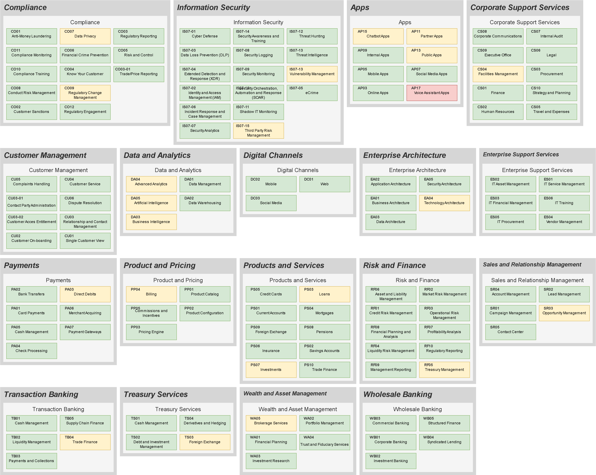
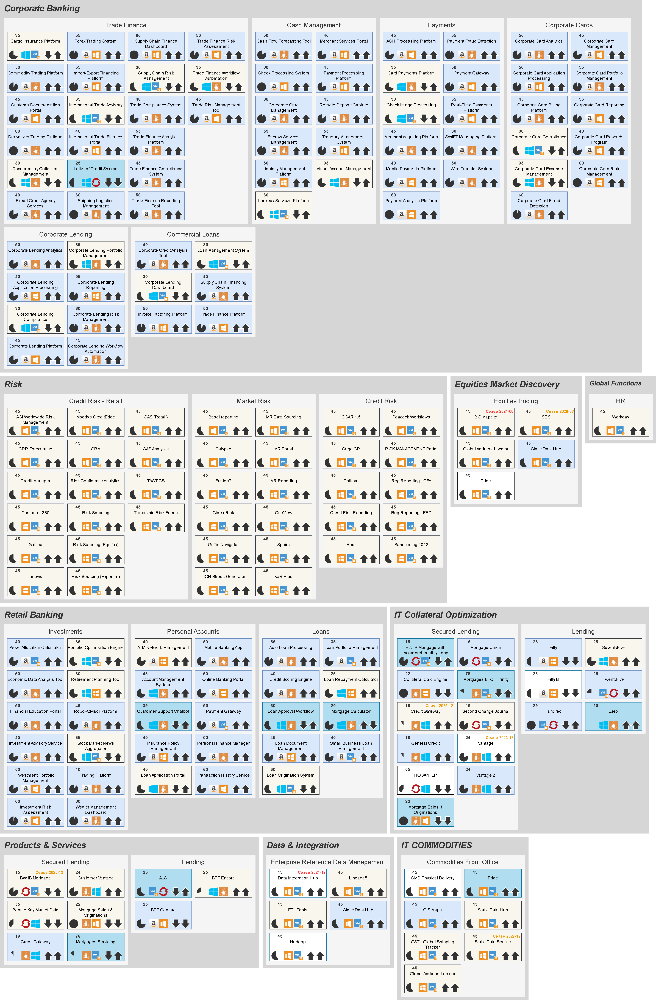

# Capability and Application Landscape in Draw.io 

We take CSV input and make it into a Draw.io diagram for embedding in Confluence or standaone use.

Features:
* Colourisation by Stategy (RAG)
* Colourisation by Category (i.e. Resilience Category)
* Metrics, Hosting and Harvey ball pictograms
* 3-layers
* Self-adjusting to page width
* Configure local setup to open Drww.io automaticall after each render



   


### Usage

Clone the repo then:

1) Update the DRAWIO_EXECUTABLE in the main.py file to point to your drawio executable
2) Run the following command to generate the application landscape map

```bash
python main.py examples\Application_Diagram_Builder.csv
```

### Experiments

1. Try toggling the SHOW_PICTOGRAMS flag in config.py to bring in the Harvey Balls, Arrows and Hosting Platform Icons
2. In Drawio, open layers and toggle visbility to show RAG status in addition to Resilience Category colourization

### Notes
Only L1 is tested at the moment. L0 would create a map one level higher than L1, but the data is not in the example file.

---

## ServiceNow Connector

Load business application data directly from ServiceNow reports. Uses Playwright for browser automation to handle SSO authentication.

### Installation

```bash
# Install connector dependencies
pip install -r servicenow_connector/requirements.txt

# Install browser (one-time setup)
playwright install chromium
```

### Quick Start

1. **Initialize configuration:**
   ```bash
   python -m servicenow_connector.main init
   cp .env.example .env
   # Edit .env with your ServiceNow details
   ```

2. **Test connection (opens browser for SSO login):**
   ```bash
   python -m servicenow_connector.main test --url https://yourcompany.service-now.com
   ```

3. **Download from a report URL:**
   ```bash
   python -m servicenow_connector.main download --url "https://yourcompany.service-now.com/sys_report_template.do?..." --transform
   ```

### Usage Modes

**Interactive Mode** - Browse ServiceNow and download manually:
```bash
python -m servicenow_connector.main interactive --url https://yourcompany.service-now.com
```

**Direct Download** - Download from a specific report/export URL:
```bash
python -m servicenow_connector.main download --url "https://yourcompany.service-now.com/cmdb_ci_business_app_list.do?CSV"
```

**Transform Only** - Convert an existing ServiceNow export:
```bash
python -m servicenow_connector.main transform --input servicenow_export.csv --output examples/Application_Diagram_Builder.csv
```

### Getting Your ServiceNow Report URL

1. Navigate to ServiceNow and open your Business Applications report
2. For **saved reports**: Copy the URL from your browser
3. For **list exports**: Go to the list view, click "Export" and copy the CSV export link
4. The connector handles SSO authentication automatically via browser automation

### Configuration

Create a `.env` file with:
```
SERVICENOW_INSTANCE_URL=https://yourcompany.service-now.com
SERVICENOW_REPORT_URL=https://yourcompany.service-now.com/sys_report_template.do?...
SERVICENOW_OUTPUT_DIR=./examples
SERVICENOW_HEADLESS=false
```

### Column Mapping

The transformer automatically maps common ServiceNow field names to the expected CSV format. Custom mappings can be configured in `servicenow_connector/config.py`.
  